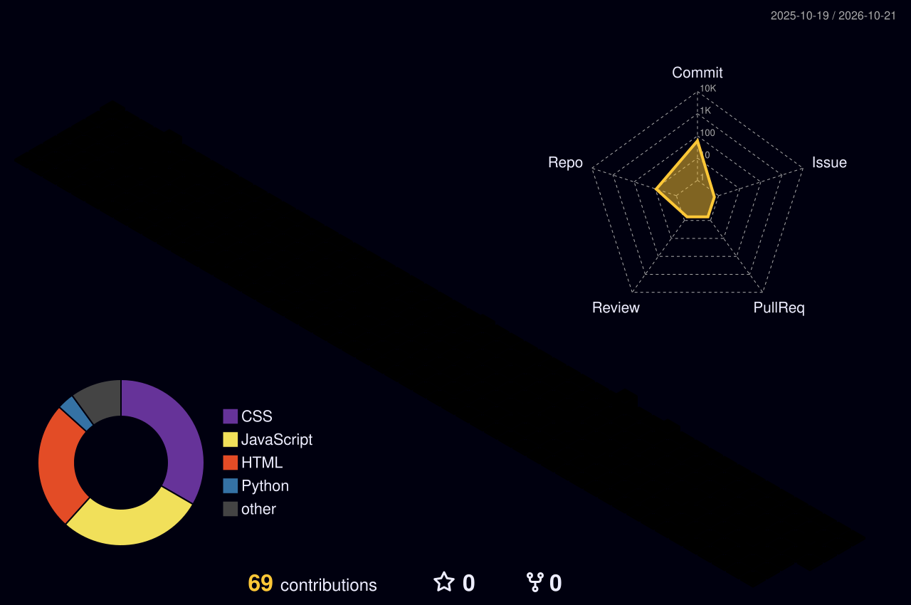

<!--
  ╔══════════════════════════════════════════════════════════════╗
  ║  Osama Abdelnaser · animated profile README                  ║
  ║  Banner text lives in assets/hero.svg (<!-- copy --> block)  ║
  ║  3D calendar + snake are generated by .github/workflows      ║
  ╚══════════════════════════════════════════════════════════════╝
-->

<div align="center">

<!-- ░░ 1. ANIMATED HERO (hand-built SVG — aurora, 3D orbits, typing caret) ░░ -->


<!-- ░░ 2. TYPING MOTION LINE ░░ -->
<a href="https://git.io/typing-svg">
  
</a>

<!-- ░░ 3. LIVE COUNTERS ░░ -->
<p>
  
  
  
</p>


</div>

<!-- ░░ 4. ABOUT ░░ -->
### 🧑‍💻 About me

```yaml
name:       "Osama Abdelnaser"
location:   "Egypt"
education:  "Computer Science · Suez Canal University"
role:       "Full-Stack Web Developer · WordPress & CMS Specialist"

what_i_build:
  - modern, scalable, user-centered web applications
  - high-performance websites and CMS platforms
  - digital solutions built around usability and clean architecture

real_world:
  - client projects in Saudi Arabia
  - website development, SEO optimization
  - measurable improvements to digital performance

open_for:
  - freelance work
  - collaborations
```

<div align="center">


<!-- ░░ 5. TECH STACK ░░ -->
### 🛠️ Tech stack


<br/>


<!-- ░░ 6. STATS ░░ -->
### 📊 GitHub statistics

<table>
  <tr>
    <td>
      
    </td>
    <td>
      
    </td>
  </tr>
</table>


<!-- ░░ 7. REAL 3D CALENDAR — generated by .github/workflows/3d-contrib.yml ░░ -->
### 🌐 3D contribution calendar



<sub>Isometric render of the last year of commits · rebuilt nightly by GitHub Actions</sub>


<!-- ░░ 8. MOTION ACTIVITY GRAPH ░░ -->
### 📈 Activity graph


<!-- ░░ 9. SNAKE — generated by .github/workflows/snake.yml ░░ -->
### 🐍 Contribution snake

<picture>
  <source media="(prefers-color-scheme: dark)" srcset="https://raw.githubusercontent.com/OsamaEllithy/OsamaEllithy/output/github-snake-dark.svg" />
  <source media="(prefers-color-scheme: light)" srcset="https://raw.githubusercontent.com/OsamaEllithy/OsamaEllithy/output/github-snake.svg" />
  
</picture>


<!-- ░░ 10. TROPHIES ░░ -->
### 🏆 Trophies


<!-- ░░ 11. SERVICES / EXPERIENCE ░░ -->
### 💼 What I work on

</div>

<table align="center">
  <tr>
    <td width="33%" valign="top" align="center">
      <h4>🌐 Web development</h4>
      <p>Business websites and web apps built with React, Node and Express — responsive, fast, and maintainable.</p>
    </td>
    <td width="33%" valign="top" align="center">
      <h4>🧩 WordPress &amp; CMS</h4>
      <p>Theme and plugin customization, CMS-based solutions, and content structures clients can run themselves.</p>
    </td>
    <td width="33%" valign="top" align="center">
      <h4>⚡ Performance &amp; SEO</h4>
      <p>Core Web Vitals, on-page SEO and UI/UX refinements that move real numbers for client sites.</p>
    </td>
  </tr>
</table>

<div align="center">

<sub>Delivered on real client projects in Saudi Arabia 🇸🇦</sub>


<!-- ░░ 12. FEATURED REPOS ░░
     Add your own repos: duplicate a block below and change `repo=` to the repository name.
     Example:
     <a href="https://github.com/OsamaEllithy/REPO-NAME">
       
     </a>
-->

<!-- ░░ 13. CONNECT ░░ -->
### 🌍 Let's connect

<a href="mailto:osama.abdelnaser.dev@gmail.com"></a>
<a href="https://github.com/OsamaEllithy"></a>
<!-- Add yours when ready:
<a href="https://linkedin.com/in/YOUR-HANDLE"></a>
<a href="https://wa.me/20XXXXXXXXXX"></a>
-->

<br/><br/>


<!-- ░░ 14. FOOTER WAVE ░░ -->


<sub>Building scalable digital experiences with clean and efficient code · open for freelance opportunities</sub>

</div>
